# Aqua Pets 🐟

*Aqua Pets was called pocket-tank until 0.4. The save format and the NVS keys keep their old layout on purpose.*

**A tiny language model keeps a fish tank alive on an $8 chip.**
The ESP32-S3 board, with screen and battery used in this project is actually around $35.

A 14-million-parameter transformer, distilled from a 26-billion-parameter
teacher, runs entirely on an ESP32-S3 microcontroller and makes every
high-level decision for a small aquarium of virtual fish: when to eat, hide,
explore, socialize, rest. No network. No cloud. The whole brain is a
7.56 MB file read straight from flash, and the tank lives on a 1.8-inch AMOLED
you can hold in one hand.


The fish aren't scripted. Each one periodically describes its situation to the
model as a single line of text (hunger, energy, fear, who's nearby, its own
personality) and the model completes the line with a goal and an urgency. A
reflex layer turns that goal into motion at 25 to 30 frames per second. When
the model isn't sure, the fish visibly *hesitates*.

```
zone 2 hunger 7 energy 5 stress 2 curiosity 8 bold 4 social 6 stage adult
species fish trust 6 bored 3 food near 12 friend mid 3 bubble mid 10 reef far 7
wall clear last explore time day  ->  seek_food urgency 8
```

This repo is the complete project: the trained model, the distillation
pipeline that made it, a PC simulator, and the firmware for a real board.
Got the board? **Install it from your browser** with the installer page in
`installer/` (see `installer/README.md`), no toolchain needed.

The current release is **v0.3.2** (alpha); the settings page shows the one
on your tank. What changed in each release: the commit history (`git log`) and
the release notes on the repository's releases page.

It runs on the Waveshare ESP32-S3-Touch-AMOLED-1.8, and a tank updates itself
over Wi-Fi, so the cable is only for the first install.


## Contents

- [The numbers](#the-numbers)
- [How it's put together](#how-its-put-together)
- [What the fish do](#what-the-fish-do)
- [The living tank](#the-living-tank)
- [Try it: PC simulator](#try-it-pc-simulator)
- [Try it: firmware in QEMU](#try-it-firmware-in-qemu)
- [Install from your browser](#install-from-your-browser)
- [Run it on real hardware](#run-it-on-real-hardware)
- [Train your own](#train-your-own)
- [Layout](#layout)
- [Documentation](#documentation)
- [Status](#status)

## The numbers

| | Teacher | Student (what ships) |
|---|---|---|
| Model | gemma4:26b | Aqua Pets 14.2M (dim 384, 8 layers, 8 heads) |
| Parameters | ~26,000,000,000 | 14,190,000, about 1,832× fewer |
| Size | ~18 GB (Q4_K_M) | 57 MB fp32 → **7.56 MB 4-bit** |
| Vocabulary | ~262K tokens | **66 tokens** (a closed schema lexicon, eleven of them species) |
| Runs on | A desktop GPU | ESP32-S3, from flash, no network |
| Agreement | | 83% picks the teacher's goal, every species above 72% (the teacher agrees with *itself* 82%) |

On the real board a decision takes about 4 s at 10 to 13 tokens per second, with
the tank rendering at 25 to 30 fps alongside it on the other core. Trained on
52,461 teacher-labeled situations. Every measured number:
[docs/stats.md](docs/stats.md).

## How it's put together

Three layers, strictly separated, all in `common/` and compiled unchanged
into both the simulator and the firmware:

- **Reflex layer** (`tank.c`, `creature.c`, `decor.c`, `helper.c`). Physics,
  steering, touch gestures, feeding, the hunger economy, vegetation and algae.
  Runs every frame and never blocks on the model.
- **LLM advisor** (`llm/`). A llama2.c-style 4-bit inference engine, a
  word-level tokenizer, and one shared state encoder. Fish are re-asked only
  when their situation meaningfully changes, so up to 25 creatures share one
  brain without anyone starving for a turn. The model runs on the second core
  of the ESP32-S3 with SIMD dot products and quantized activations in
  internal SRAM; the weights are memory-mapped from flash and never copied.
- **Progression** (`progression.c`). The long game: growth, arrivals, trait
  drift, milestones, habits, persistence. Everything survives a power cut.

One deliberate rule: **the model owns its decisions.** There are no fallback
heuristics second-guessing it. If the model picks a goal, the fish commits.
Uncertainty shows up as visible hesitation, not a silent override. The reflex
layer only ever *performs* what the model chose, or stages presentations
(begging, courtship, greeting) that the model's own state has earned.

## What the fish do

Seven goals: `seek_food`, `follow_friend`, `inspect_reef`, `visit_bubbles`,
`explore`, `rest`, `dart_play`. (The vocabulary keeps an eighth, `flee_shadow`,
that the model is never taught to say.) Each fish has five drives (hunger,
energy, stress, curiosity, boredom), three personality traits (bold, sociable,
lazy), a trust score toward you, and a life stage. All of it is in the state
line, so a bold fish and a shy one answer the same situation differently, and
the model was taught by example rather than by rules.

**Boredom** is what keeps the tank moving. A fish that has been at the same
pastime for about a minute goes stale, and the model was taught that a bored
fish moves on, usually to explore a part of the tank it hasn't seen in a
while; a fresh fish keeps doing what it was doing. Boredom never outranks
hunger, and a bored fish at night still rests.

The model samples its own distribution instead of always taking the top
answer. That restores the variety the teacher had and costs nothing on
survival. When the top two choices are close, the fish pauses for a moment
before committing.

Fish turn the way real ones do. A fish whose way lies behind it commits to
turning round instead of flip-flopping: it glances back first, then its
head swings through a head-on view, the body shortening toward the glass
and the tail following a beat behind, and it pulls away. Its body stays
near level as it rises and sinks.

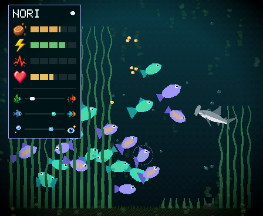

Tap a fish for its stats card, its name at the top. Needs, traits, and trust are
revealed as the fish shows that side of itself, so a new fish's card is mostly
blank. Tap the card (or the open water) to put it away.

**The main menu.** Press the BOOT key (the small one) for the main menu: TANK
(the milestones page), UPGRADES (the shop) and SETTINGS across the top, the
tools below - the SPONGE, the SCISSORS and FEED - standing over the live
tank the way a fish's card does, with the battery up in the corner. Each page's
CLOSE brings you back to the menu; BOOT on a page does the same, and BOOT on the
menu (or a tap off its tiles) goes back to the tank.

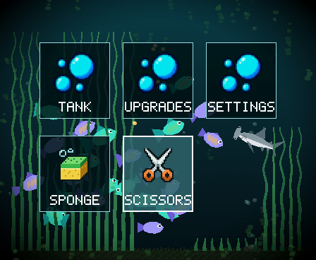

## The living tank

Everything below is detected from what actually happens in the tank, never
scripted, and it is all persisted.

**Growing up.** A new tank starts with two fry. Feed them and over days they
grow through juvenile, adult, and elder. A fry is plain; its markings come
in with its first growth spurt. Adults get a dorsal crest; elders
get bigger and settle down. Fish grow with time, lit or not, and at a quarter
speed while the tank sleeps; a stage reached in the night is the morning's
surprise.

**Arrivals.** Take good care of the pair and the tank earns more fish, up to
25 creatures, one at a time (the gates get harder as the tank fills: more
meals, more trust). Each arrival has conditions (trust, feedings, a fish
grown up, a hold-approach) and the tank *tells* you when it's close: the two
most trusting adults dive into the sea grass and circle low through it.
Once every condition is met, the pair goes down into the grass within half
a minute and courts, and a few seconds into the dance there's a fry between
them, light on or off. Put the tank to sleep before that and the fry is
there when it wakes. A bed has to be tall enough to hide in before courtship
starts or a fry can be born.

**Trust.** Hold a finger on the glass for three seconds and the fish that
trust you come over from anywhere in the tank, the most trusting first and
fastest. A resting finger earns trust, and the model reads trust as part of
every decision, so a fish that trusts you acts differently in every situation.

**Hunger.** A meal lasts five or six minutes awake. Left alone, the tank
drops a pellet only when someone is really hungry, so an untended tank hovers
between fed and peckish. Wake it after hours asleep and the school is
ravenous: they gather just under the surface where you usually feed them,
darting back and forth, and go into a frenzy when the pellets land. The tank
holds off feeding itself while they beg, so the first meal is yours.

**Feeding is yours if you want it.** AUTO FEED on the settings page turns the
tank's own pellets off: then every meal is one you gave. Nobody dies of it, but
a fish left starving in a lit tank slowly loses trust, and feeding it stops the
loss.

**Upkeep.** The sea grass keeps growing, every frond on its own, up toward the
surface. With the scissors a sideways stroke cuts exactly the fronds it crosses
at the height of your finger; a sweep along the floor mows a bed down to nubs.
Algae films the glass over hours, and a drag of the sponge across it squeegees
it clean. Fish like cover: grass calms them, and only a tank truly smothered by
two beds at the ceiling stresses them.

**The tools.** Your bare hands only reach the creatures: a tap checks on one,
two quick taps set off its trick, and a held finger draws the trusting ones
over. Feeding, wiping and trimming are tools on the main menu's bottom row. Pick
FEED and every tap drops a portion of food at the surface over your finger; pick
the sponge and your strokes wipe algae; pick the scissors and they trim the
grass. While a tool is in your hand the glass takes its work and nothing else. A
DONE chip sits top left: tap it to put the tool back (or pick it again on the
menu), or leave it and it goes back by itself after two minutes.

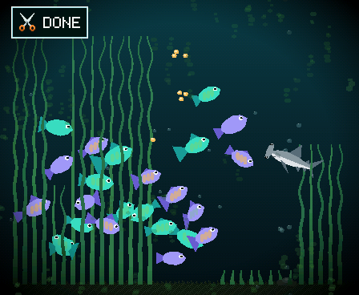

**Milestones.** Press BOOT and tap TANK for the milestones page: a row per
creature with its sprite at its real size, its name and a growth strip, then a
badge for each first it has chosen to do: first meal from you, first
hold-approach, first rest in the seagrass, first bubbles, first follow, first
dart. The tank's row below tracks the population and the firsts you share: first
feeding, first trimming, first glass cleaning, first full night's sleep, first
play session, the tank changed someone, plus a school of ten shrimp and a first
visit to the reef once you own them. A locked badge is the same picture as a gray
silhouette; one earned since you last looked wears a ring. Tap a badge to read it:
a small panel with arrows at its top corners that step through the rest of the
group without going back to the page; tap anywhere else to dismiss. Tap the tank's
fish count to see every creature in its own colors, with an outline for each open
place.

Past six creatures the rows scroll up and down with a thin bar at the right, and
when the tank's row holds more badges than fit, the next one peeks in at its right
end: drag it sideways. A teal mark on a bar's end says a badge you haven't seen
lies past it.

**The next fry.** While the tank can still grow, a NEW FRY row sits under
the last creature: what the next arrival needs, as badges that light up when
met, with a filling bar under each one still owed. The list is read from
the same rule that decides a birth, so it is never wrong: at two fish it
is trust, meals and a calm hold; later the youngest must grow up, and the
counts rise; and always clean glass and some grass, because no fry is
conceived in a dirty tank (film on more than 15% of the pane closes the
gate, and its bar fills as you wipe). Tap a badge for the plain words and where
it stands ("ALL FISH MUST HAVE TRUST OF AT LEAST 6 OUT OF 10 / LOWEST NOW 4.1"),
and HOW? for a tip on how to get there. Tap the name for the tally. When every
step is done, the parents court in the grass and the fry is born within the minute.

**Rename or sell a fish.** On the milestones page, tap a fish's name to
open its card. RENAME brings back the letter wheel. SELL, tapped twice,
trades the fish for sand dollars, and older fish are worth more: 5 for a
fry, 15 for a juvenile, 30 for an adult, 60 for an elder (a shop creature fetches
its price at most). A tank keeps at least two fish, and after a sale the next fry
waits for 12 more meals.

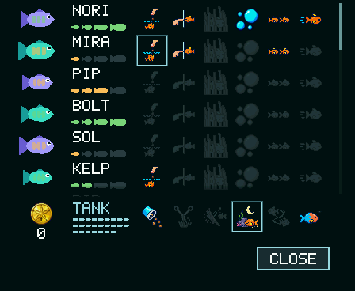
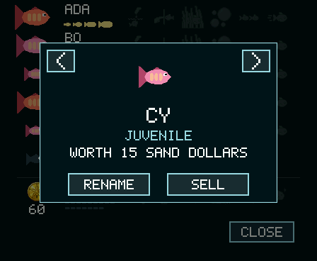
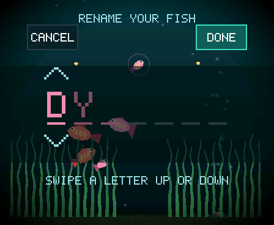
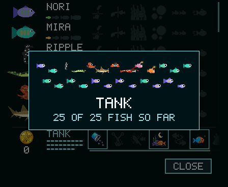
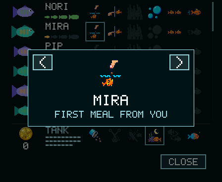
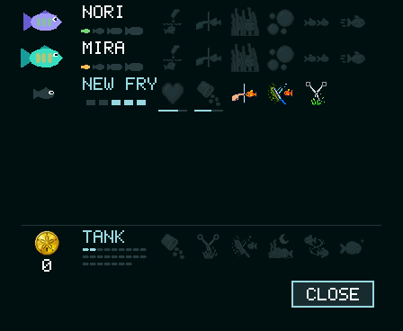
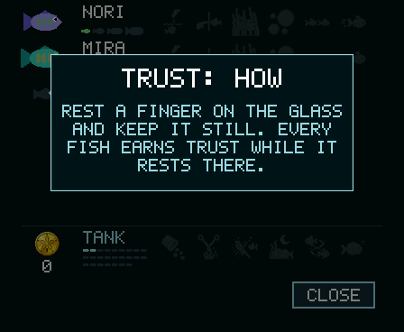

### Sand dollars and the shop

Caring for the tank earns points, and the shop spends them on things for the tank.
A meal the fish eat from your hand pays 2; a fish growing up pays 5, 10 and 25 for
juvenile, adult and elder; a fry born 20; a fish that comes to trust you completely
15; every hundred algae colonies you wipe away pay 25, and so does every 250 cm of
grass you cut, again and again. Nothing is ever needed and nothing is lost: a tank
with no sand dollars is a complete tank. Dollars earned while you watch show as a
small "+N" over the water.

The coin on the milestones page's TANK row shows your balance, and it (or UPGRADES on
the main menu) opens the shop: a list with a row per item, its price, UNLOCK when you
can afford it, IN TANK once you own it, and HOW TO EARN for the list. Drag it to
scroll, flick it to fling, and a thin bar at the right shows where you are.

**Placing what you buy.** A decoration is yours to put down. Right after you
unlock it the shop closes and a placement page comes up over the live
water: drag it left or right along the floor and it follows your finger. A DEPTH bar
sets where it stands among the fish, and instead of words to decode it shows small
pictures of your own first fish with two leaves. The tank redraws as you choose, a
line under the bar says what to watch for, and DONE keeps it. A piece's row in the
shop has a MOVE button that opens the same page again.

**Selling back.** Anything you own sells back: SELL sits next to MOVE in a piece's
modal, in the top-left corner of its placement page, and alone on a helper's. It
takes two taps: the first arms the button and shows the refund, the second sells. You
get 20% of the price back, the thing leaves the tank, and it is in the shop again at
full price.

#### Decor

Decor stays where you put it. All of it is drawn from a little geometry rather than a
sprite, lit from the upper left and tinted by the water of its row, so it sits in the
tank instead of on it.

- **The sword plant** (40) is a fourth bed of broad leaves on the open floor, trimmed
  and grown and counted as cover like the grass. It stands BEHIND, AMONG or IN FRONT.
- **The castle** (150) is a stone castle with a swim-through arch. BEHIND puts it behind
  the grass and the fish, a ruin in the weeds; IN FRONT stands it in front of the grass,
  and the fish swim through the arch, tucked behind the jambs as they pass. The fish do
  not know it is there. They find the arch by chance, which is most of the charm.
- **The wreck** (200) is a small sunken boat lying on the sand: a planked hull tilted up
  toward the bow, a broken mast with a rag of sail, an anchor with its chain up to the
  prow. It has two big holes: IN FRONT, the fish pass behind the hull and show through
  them; BEHIND it is a backdrop. The octopus, crab and lobster den under its holes when
  there is no reef.
- **The coral** (100) is a branching fan in whatever colour you give it, from a row of
  eight swatches on its placement page. It grows, and slowly: you buy a young but
  established fan, and over about seventeen days, awake or asleep, the rest of the
  branches reach out one by one. It tops out about a quarter of the way up the glass.
  Then, over the following week, a crown of thin tentacles sprouts from the tip and sways.
- **The reef cluster** (240), the dearest, is a whole mature reef on a pile of stones: a
  branching coral, four tube sponges, a lobed brain coral and green weed. You buy it big,
  at 85% of its full size; over two weeks it fills out, and over two more it blooms, up to
  forty-eight thin tentacles appearing one at a time. Its placement page has a LOOK row of
  three: REEF, LAGOON and DUSK. Once you own one, the fish's reef is the cluster: they swim
  over to visit it.

The coral and the cluster are anchored: their base sits down in the pebbles with a low hump
of the floor's own stones heaped round it.

#### Helpers

Helpers go about their own rules. They are never placed or bred, and the model never sees
them: they reach the fish the way your own chores do, through cover and the film.

- **The snail** (80) grazes the glass clean cell by cell, crawling flat across the pane
  with its head leading, and walks the floor upright when there is nothing to eat. Waves
  run along its foot, its eye stalks sway, its shell rocks with the crawl. Tap it for its
  card: a tally of the spots of algae it has grazed so far.
- **The sea urchin** (120) lives on the sand and nibbles the tallest grass down a little
  at a time. It never cuts the grass short and it leaves the sword plant alone, so there
  is still trimming for you to do. Tap it for how much it has eaten and what it is up to.
- **The shrimp school** (180): four cherry shrimp keep to the foot of the grass, wander
  onto the sand, and now and then drift up a bed to the top of its canopy. They are the
  cleanup crew: a pellet that sinks below the top of the grass is theirs, and pellets rest
  on the floor fifteen seconds before they dissolve. Every ten pellets brings another shrimp,
  up to ten, never two within fifteen minutes. With more than half the glass covered in algae
  they refuse food, so the school stops growing until you wipe it. Tap the school for its card.
- **The frogman** (10) is a little diver in a banded wetsuit who floats sideways across the
  water from glass to glass, easing to a new lane now and then, a mist of bubbles rising from
  his mask. Every so often his arm goes up and waves.
- **The submarine** (60) cruises the water the same way, propeller turning; every 22-40 s it
  eases to a halt, a periscope rises, looks each way, and sinks before it goes on. It and the
  frogman never collide: when they close nearly level each eases off to the far side.

**The night shift.** The snail and the urchin keep working while the tank sleeps. A tank with a
snail wakes up with about a third less algae on the glass, and a tank with an urchin wakes up to
shorter grass. Helpers take the edge off a long sleep; they never take the chores away.

#### Creatures

Twelve species join the classic fish, each a juvenile in the shop at 10 sand dollars, bought one
at a time (two of a kind breed): seahorses, octopuses, pufferfish, anglerfish, electric eels,
hammerheads, squid, crabs, lobsters, jellyfish, swordfish and sea turtles. Each comes in four
designs, has its own temperament, and moves like the real animal: the seahorse holds the grass by
its tail, the octopus takes the colour of its den, the anglerfish's lure glows, the eel rises for
air, the hammerhead never stops, the crab walks sideways, the jellyfish pulses, the turtle naps on
the sand. They breed within their kind, and now and then a classic pair's fry hatches as something
else entirely, a surprise.

**Two quick taps** on a creature set off its trick, if it has one: a pufferfish puffs up, a squid or
an octopus squirts ink, a seahorse grips a stem, a crab raises its claws and scuttles off, a lobster
flips its tail, a jellyfish pulses away, an eel sparks.

The whole design is in [docs/species.md](docs/species.md).

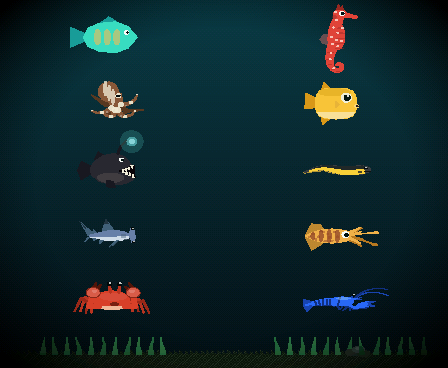
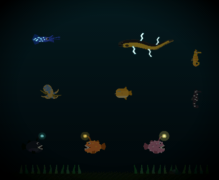
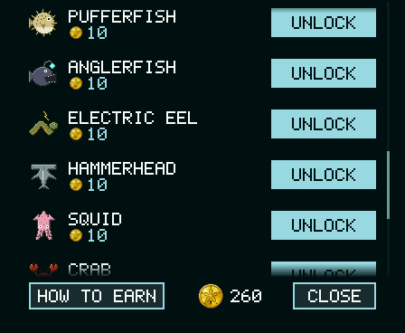

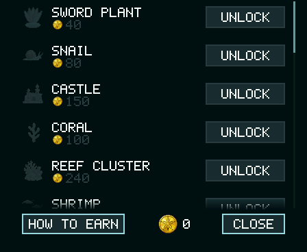
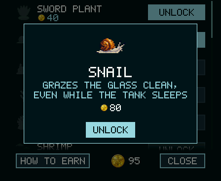
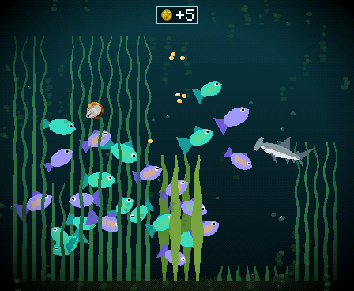
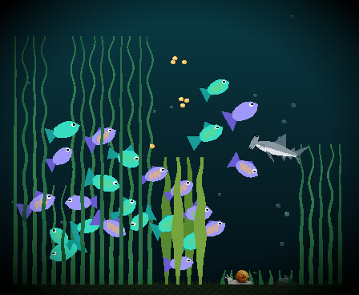
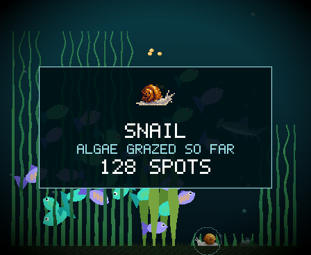
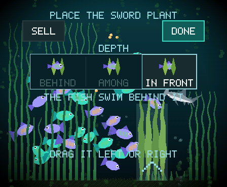
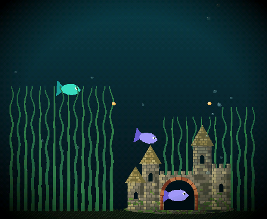
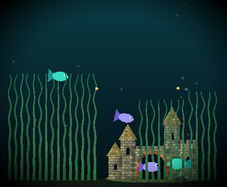
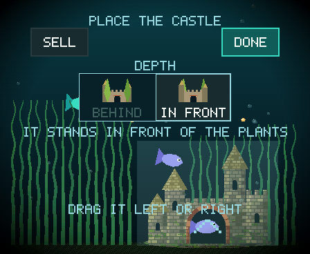
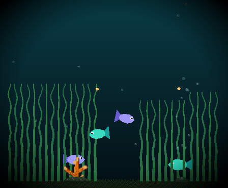
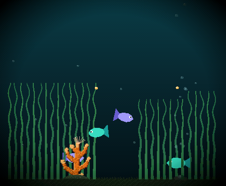
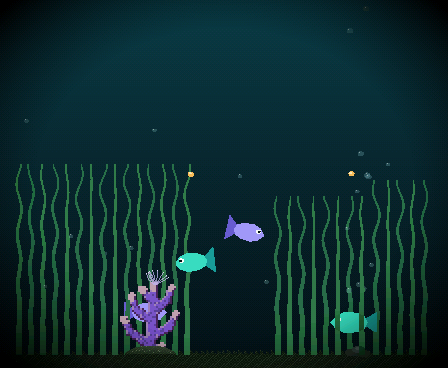
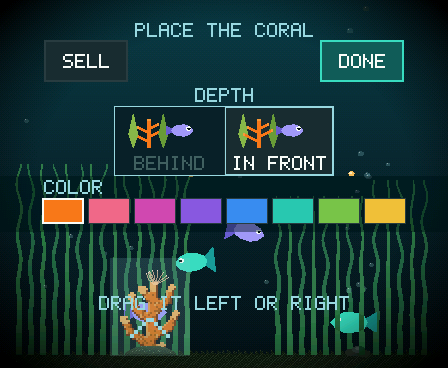
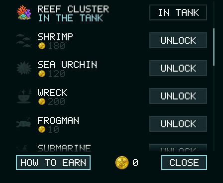


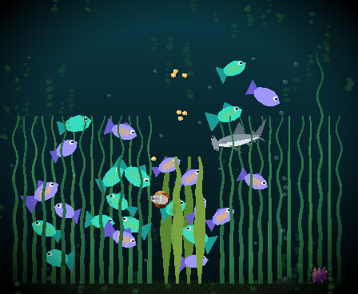
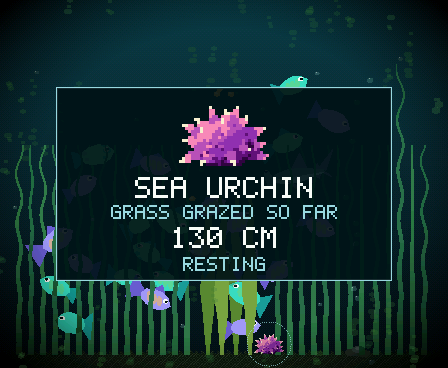
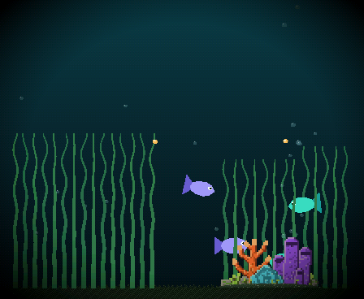
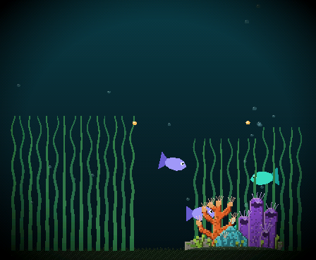
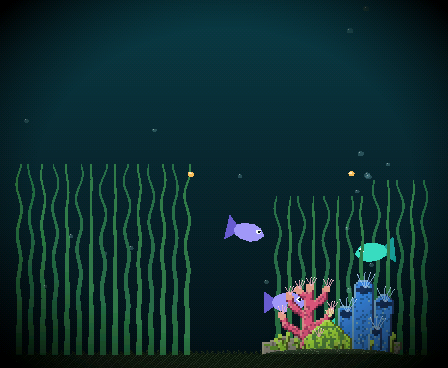
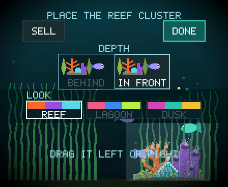
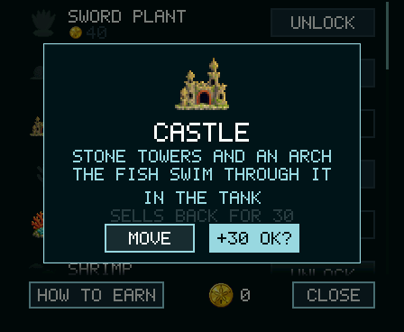

### The tank and its settings

**The light.** The settings page's LIGHTS OUT row decides it: NEVER (the default) keeps the light on,
or step it to a time, 5 seconds up to 30 minutes. The tank knows when it is being handled (the motion
sensor, or a touch) and goes dark by itself after that long still, so a tank left on the desk is asleep
until you pick it up; in the dark the fish rest and the palette dims. Six hours of device sleep in one
stretch earns the tank its first full night's sleep.

**The night and the battery.** The frame rate drops to 10 fps while the light is out and no finger is on
the glass, and after two hours of darkness with nothing handling the tank (no touch, no motion; not while
a cable is charging it, not while a page is up) it takes the same sleep the PWR key does. The PWR key
brings it back and the night is lived through at that boot.

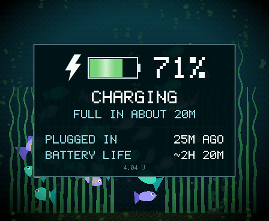

**The battery.** A small battery sits top right whenever the main menu is open, and stays up by itself when
the charge runs low. On the cable a lightning bolt stands beside it, and while it charges a bright band runs
through the fill, so you never have to tell two colors apart to know it is charging. Plug the tank in and the
battery shows itself for a few seconds to say it noticed. Tap it for the battery page: the charge, whether it
is charging, about how long it will last (or how long until it is full), how long ago it was unplugged, the
screen-on time since, and how long a full charge lasts. The tank learns those times from its own battery as
you use it.

**The settings page.** BRIGHTNESS and VOLUME; LIGHTS OUT; AUTO FEED; ROTATION (the picture turns over when you
turn the tank over, and this button, a padlock in a turning arrow, locks it the way up it is); UPDATES and RESET
side by side; ABOUT and CLOSE at the foot. RESET starts the tank over: it opens a NO / YES prompt with a timeout,
so a stray tap wipes nothing.

**About.** The ABOUT button shows the game's name, who makes it (Softworkz Pte Ltd), the release and the build id,
with a little fish crossing above them and bubbles rising, and an underwater jingle that loops while the page is
up, synthesised on the device (`common/audio.c`: twelve bars of an arpeggio, a hummed melody, a soft pad and bubble
chirps; nothing in the sound bank). It follows the VOLUME setting.

**Updates over Wi-Fi.** The settings page has an UPDATES button. Tap CHECK FOR UPDATES and the tank pauses, turns
its radio on and looks for a newer release. The first time, it lists the networks it can see; pick yours and type
the password on the glass. If there is a new version it downloads it, checks it and restarts into it, and your fish
are right where you left them. Below about 20% battery it asks you to plug in first. If an update ever goes wrong,
the tank goes back to the version it had. The radio is only on during a check: the tank itself still runs with no
network at all.


**Habits and continuity.** The tank remembers where you feed it and greets the light coming on. A real-time clock
tells it how long it was off, so a tank left dark for a day wakes hungry. One key does all of it: a short press on
PWR puts the tank to sleep - it saves and the screen goes dark - and a press wakes it. Press again within twenty
minutes and the tank simply resumes where it was, on a tap; after that it powers itself down to the board's deepest
state (tens of microamps, months on the shelf), and the next press wakes it with a one-second boot, the fish having
lived through the time away: hunger up, energy back, the grass and the algae grown, a long night ending in begging at
the surface. One thing to know about that deepest sleep: the only chip still awake is the power-management chip, and
its rule is that the key must be held for about an eighth of a second before it turns the board on - a quick tap does
nothing. Press it like you mean it. The tank decides how deep it sleeps; you never do. Holding PWR powers it off at
once. A short press of BOOT opens the main menu; hold BOOT and tap the glass to reset the tank.

**First run.** A new tank, whether a fresh install or a reset, opens with a short setup over the live water. A welcome
page; then you place the bubble column, dragging it left or right across the tank while the bubbles and the airstone
follow your finger; then each of the two fry in turn: the fish being introduced swims a slow loop front and center with
a ring around it while you name it on an arcade-style letter wheel (touch a slot, drag up or down to spin its letter, or
tap the chevrons above and below it), then you pick its body color from eight swatches and watch the fry wear it. Its
accent stays a question mark: a fry has no markings yet, and they come in as it grows. A page of care tips finishes the
tour. The light stays on throughout, and the column, the names and the colors you chose are saved with the tank.

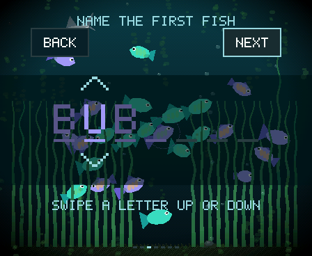

**A birth.** Every arrival is an event. The fry hatches low in the nursery grass wearing its family's colors, the body
of one parent and the markings of the other, and the tank stops to introduce it. *A new fry!* rings the newcomer wherever
it is and names its parents; the next page is the same letter wheel, so you name it; the last page shows the fry on its
own, as it is now, with what it inherited: whose body, whose markings, and how bold and sociable it is on bars marked with
each parent's own value. The welcome is saved with the tank until you finish it, so a fry born while you were away is
waiting for you when you come back.

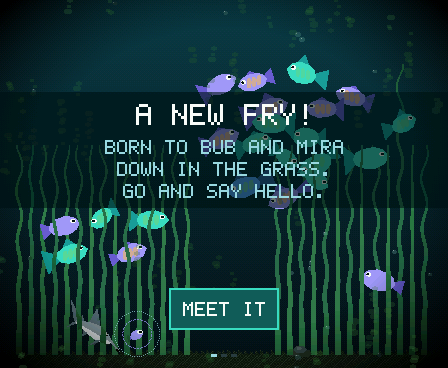
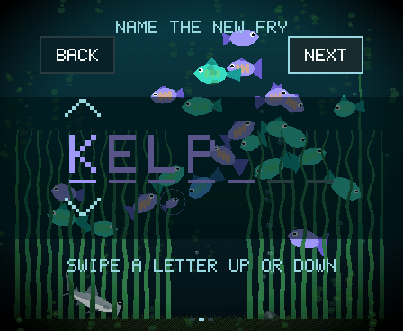
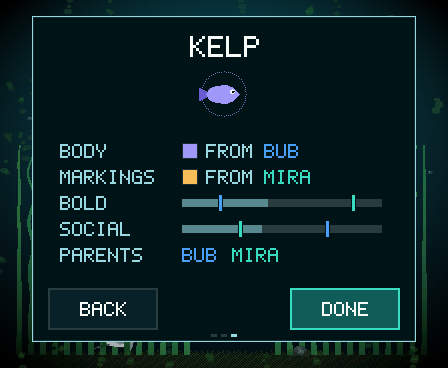

**Starting over.** Settings' RESET, or hold BOOT and tap the glass: a *Reset tank?* prompt appears over the water with a NO
and a YES. YES wipes the save and two new fry take the tank, with the first-run setup to name them; NO, a sleep, or twenty
seconds of silence keep everything.

## Try it: PC simulator

The simulator runs the exact same `common/` code inside an LVGL + SDL2
window, with the shipped model as the brain. Needs SDL2 and LVGL v9 (cloned
in-tree):

```bash
git clone <this repository> aqua-pets
cd aqua-pets
git clone --depth 1 --branch v9.2.2 https://github.com/lvgl/lvgl.git sim/lvgl
brew install sdl2        # macOS; apt install libsdl2-dev on Linux
cd sim && make && ./fishsim
```

On macOS the Makefile targets x86_64 by default to match an Intel Homebrew
SDL2; use `make ARCH=` for a native build. On Linux it builds for the host.
The trained model (`model/out/model_q4.bin` + `tokenizer.bin`) ships in the repo,
so the LLM brain works out of the box.

On Windows, build in [MSYS2](https://www.msys2.org/)'s **UCRT64** shell
(the Start menu's "MSYS2 UCRT64", not plain "MSYS2"):

```bash
winget install MSYS2.MSYS2                 # from PowerShell, once
# then, in MSYS2 UCRT64:
pacman -S --needed mingw-w64-ucrt-x86_64-gcc mingw-w64-ucrt-x86_64-SDL2 make git
cd /c/path/to/aqua-pets
git clone --depth 1 --branch v9.2.2 https://github.com/lvgl/lvgl.git sim/lvgl
cd sim && make && ./fishsim.exe
```

The Makefile includes `sim/win_compat.h` on Windows (the few POSIX calls
MinGW lacks) and builds a console app, so the selftests can print. For
`make check`, add this line to `C:\msys64\etc\fstab` and reopen the shell:

```
C:/tmp /tmp ntfs binary,posix=0,noacl 0 0
```

The selftests write their scratch saves to `/tmp`, which the native
`fishsim.exe` reads as `C:\tmp`, and they back those saves up with the
shell's `cp`. Without that line, MSYS2's `/tmp` is a different folder,
so the restore misses and the shop, sleep and tend tests fail.

In the window, the mouse is your finger: click a fish for its stats card
(the shrimp for theirs), click the card to put it away, hold the button to
rest a finger on the glass, two quick clicks on a creature for its trick.
Feeding, wiping and trimming take the menu's tools (**Space**, then
FEED, the SPONGE or the SCISSORS): FEED's click drops food, the sponge's
drag wipes, the scissors' sideways stroke trims.

Keys: **Space** the BOOT key (the main menu), **M** milestones, **4** the shop,
**E** update mode, **S** the first-run setup (or drops a birth's pages), **X** the
reset prompt, **F** feed at the mouse, **D** fifty sand dollars to try the shop,
**R** force an arrival (the birth flow opens), **N** light, **A** auto light, **H**
handle the tank (moving the mouse over the window counts too), **L** switch between
the rule stub and the LLM brain, **U** overlays, **V** volume, **B** the low-battery
notice, **P** plug or unplug a pretend battery (click the battery for its page),
**5** a pair of the next species, **C** the castle, **K** the coral, **I** the reef
cluster, **W** the shrimp, **Y** the urchin (all free, for a look), **Z** jump through
seven hours of sleep, **G** grow the grass and algae now, **Q** quit.

Flags: `--fresh` starts a new random tank, `--fast N` runs tended time N×
faster so you can watch fish grow up, `--greedy` disables sampling,
`--narrate` prints every decision as it's made, `--battery N` starts the
pretend battery at N%, `--snapshot <prefix>` writes PPM frames of every page.

`make check` from `sim/` runs every selftest, headless, without a window (the list is
`SELFTESTS` in `sim/Makefile`, and one runs alone as `./fishsim --selftest-shop`).
`--bench` profiles the render cost.

## Try it: firmware in QEMU

The ESP-IDF v5.4 app boots in Espressif's QEMU with the real hardware
configuration (octal 8 MB PSRAM) and the model partition populated:

```bash
cd firmware && ./run_qemu.sh
```

You'll watch an emulated ESP32-S3 memory-map the 7.56 MB model from flash
and start making decisions, about 2.3 s each in emulation. The display and
touch ports are stubs in the QEMU overlay; decisions go to the log.

## Install from your browser

The easy way onto a board: the browser installer page (`installer/`, hosted
over HTTPS - `installer/README.md` says how). Plug the Waveshare board into your
computer, open the page in Chrome or Edge, click *Install Aqua Pets*, pick the
port, and watch the bar fill. Then the page asks for your Wi-Fi: the tank's screen
stays dark while it lists the networks it can see, you pick yours and type the
password, and the tank connects to check it before it starts. That is what lets it
update itself later; you can skip it and set it up on the tank instead. About
8 MB goes over in a minute or two, the board reboots on its own, and two fry
are waiting.

**After that, updates come over Wi-Fi:** CHECK FOR UPDATES on the settings page
does the rest. Every image is signed, and a tank refuses one that is not signed by
this project or was built for another board. [docs/OTA.md](docs/OTA.md) has the design.

**Updating by cable is the same click.** The installer never erases the board: it
rewrites the app and the model, and the tank's save lives in a part of the
flash (NVS at `0x9000`) that none of the four parts cover, so your fish,
their names, trust, history, badges, sand dollars and decorations carry on. Every
release on save layout 3 loads the saves of the ones before it; a tank saved before
layout 3 starts fresh. To start over, use RESET on the settings page; the installer
also has an "erase and install fresh" button for a board that won't get that far. The
settings page shows the release at its foot, small and dim ("V0.3.2 ALPHA", then the
build id), so you can tell what you run. It is the same mechanism ESPHome and Home
Assistant use ([ESP Web Tools](https://esphome.github.io/esp-web-tools/)),
running entirely in the browser over Web Serial.

To host your own copy, `tools/make_installer.py` turns a firmware build plus
the shipped model into one static folder (`installer/dist/`: the page, a
manifest with the four parts and their flash offsets, the binaries, and the
vendored flasher). Any HTTPS static host will do, GitHub Pages included;
[installer/README.md](installer/README.md) has the details.

## Run it on real hardware

One Waveshare board is supported for now: the
**ESP32-S3-Touch-AMOLED-1.8** (V1 and V2, auto-detected), an ESP32-S3R8 with
16 MB flash and 8 MB PSRAM, an AMOLED (368×448, shown as a 448×368 tank),
capacitive touch, an IMU and a PMIC. [docs/BOARDS.md](docs/BOARDS.md) has how a
board is built in. The browser installer above is the no-toolchain path; this is
the developer one, with ESP-IDF v5.4:

```bash
tools/ota_key.sh            # once: the signing key, in firmware/keys/ (never committed)
tools/flash.sh --model      # archive the tank's log, build, flash the app and the model
```

`tools/flash.sh` is the only way to flash a running tank ([docs/DEVICE.md](docs/DEVICE.md));
a blank board starts with [docs/bringup.md](docs/bringup.md), the step-by-step checklist with
pass signals for each stage. A tank you flash with your own key takes over-the-air updates
only from images signed with that key, not from this project's releases; the browser
installer is the way onto the release channel.

The model lives in its own 8 MB raw partition and only needs flashing once.
[docs/memory_budget.md](docs/memory_budget.md) explains where every kilobyte goes. The boot
log prints a per-stage frame profile and per-decision inference timings, so performance work
is measurable without instruments.

**Other boards.** Two community ports run the tank elsewhere. They are not built or tested
here, and they may lag behind this repo:

- [knoopx](https://github.com/knoopx) ported it to the Waveshare
  **ESP32-P4-WIFI6-Touch-LCD-4B** (4-inch 720×720 MIPI-DSI panel, GT911
  touch, ES8311 audio) in [their fork](https://github.com/knoopx/pocket-tank).
  It needs ESP-IDF 5.5. Upstream pull request #5 has the details.
- [lmoiseichuk](https://github.com/lmoiseichuk) ported it to the 2.8-inch
  **ES3C28P "cheap yellow display"** (ESP32-S3, 320×240 ILI9341 IPS panel,
  FT6336 touch, ES8311 audio), with every page laid out for the smaller
  screen, in
  [their fork](https://github.com/lmoiseichuk/pocket-tank-cyd/tree/feature/cyd_ES3C28P).
  Upstream pull request #10 has the details.

## Train your own

The whole distillation pipeline is here. `model/gen_traces.py` runs the
headless tank against any Ollama-served teacher and logs state→goal pairs;
`train_tokenizer.py`, `train.py`, and `export_q4.py` take it from JSONL to a
flashable 4-bit binary; `eval.py` measures agreement with the teacher on
fresh situations. It builds on a clone of
[karpathy/llama2.c](https://github.com/karpathy/llama2.c) in
`model/llama2.c/`.

Step-by-step commands: [docs/pipeline.md](docs/pipeline.md); a whole data cycle:
[docs/retrain.md](docs/retrain.md). Two things the project learned the hard way, both
documented there: the teacher prompt is the DNA of the whole dataset (one sentence moved a
goal from 45% of labels to 14%), and a prompt check before an overnight run is always worth it.

## Layout

- `common/` — everything shared verbatim by sim and firmware: `tank.c` (the reflex layer),
  `creature.c` / `creatures.inc` (every creature's rules and art), `decor.c` and `helper.c`
  (the static pieces and the helpers, with their `.inc` art), `glass.c` (the glass's shape),
  `render.c` (the RGB565 software renderer and its pages), `setup.c` (first run, the birth flow,
  placing a piece), `progression.c` (the long game, the sand dollars and persistence),
  `scroll.c` (a list's scroll), `icons.c` (baked pixel art), `audio.c` (the sound mixer),
  `notice.c` (the announcements), `update.c` (the update pages and their flow), `devices/` (the
  board's numbers), `llm/` (4-bit engine, word tokenizer, the shared encoder)
- `sim/` — the LVGL + SDL2 simulator, its ports, and the self-tests
- `firmware/` — ESP-IDF app: display, touch, battery, IMU, RTC and audio ports, the on-device advisor
  scheduler, update mode and its Wi-Fi port, the QEMU harness, and the partition table
- `model/` — the frozen [state/goal schema](model/schema.md), trace generation, training, evaluation,
  probes, and the 4-bit export
- `installer/` — the browser installer page and the vendored ESP Web Tools bundle;
  `tools/make_installer.py` assembles the upload folder
- `tools/` — the icon baker, the sound bank builder, the installer assembler, the release manifest
  maker, the flash tools, the touch calibration fitter, the picture sheet, and a serial bench client
- `assets/icons/` — the pixel-art source for the stats card, the badges and the shop
- `assets/sounds/` — the cues (16 kHz mono) and their levels

## Documentation

- [docs/progression.md](docs/progression.md) — population, growth, trust, chores, milestones, the shop
- [docs/species.md](docs/species.md) — the creatures and helpers: breeding, designs, how each one moves
- [docs/stats.md](docs/stats.md) — every measured number
- [docs/pipeline.md](docs/pipeline.md) — teacher to flashable binary
- [docs/retrain.md](docs/retrain.md) — the retrain runbook, and what is queued
- [model/schema.md](model/schema.md) — the state encoding and goal output
- [docs/BOARDS.md](docs/BOARDS.md) — what is shared, where a board may differ, how a release keeps it to its own image
- [docs/THEMES.md](docs/THEMES.md) — what a theme is
- [docs/DEVICE.md](docs/DEVICE.md) — what is in flight on the device, and the flash rule
- [docs/OTA.md](docs/OTA.md) — updates over Wi-Fi: update mode, signing, the manifest
- [docs/AUDIO.md](docs/AUDIO.md) — the sound design: the cues, the asset pipeline, the power rules
- [docs/memory_budget.md](docs/memory_budget.md) — flash, PSRAM, and SRAM plan
- [docs/bringup.md](docs/bringup.md) — hardware bring-up checklist

## Status

- ✅ Model: schema v5 (species, boredom), 14.2M student, 4-bit export, evaluated
- ✅ Simulator: the full tank with progression, self-tests, snapshots
- ✅ Firmware: running on the real board at 25 to 30 fps and about 4 s per decision, with touch,
  auto-rotation, a battery gauge and log, and one key for sleep and wake
- ✅ The living tank: growth, arrivals with courtship, trust, the hunger economy, upkeep chores,
  milestones, the first-run setup, births announced and named with a family page, a sleep that lives
  through the night at the next boot, fish that get bored and go exploring
- ✅ Sound: the board's own little speaker plays cues for what you do and for the fish, plus a
  welcome, a birth fanfare and milestone chimes with an on-screen announcement
- ✅ Sand dollars: care earns points, the shop spends them on decor you place yourself, helpers and
  twelve species that breed within their kind, up to 25 creatures a tank
- ✅ Browser installer and signed updates over Wi-Fi
- 🚧 Next: more to unlock: more plants, corals, and more tank maintenance critters
- 🚧 Next: more achievements and milestones

## The video series

This repo is the companion to a YouTube series documenting the build:
distilling the model, designing the schema, squeezing inference into PSRAM,
first boot on real glass, and the tank growing into a pet.

**▶ Watch:** https://youtu.be/C2z7x47xxdM

## License

MIT, see [LICENSE](LICENSE). `model/llama2.c/` and `sim/lvgl/` are cloned
separately and carry their own MIT licenses.
